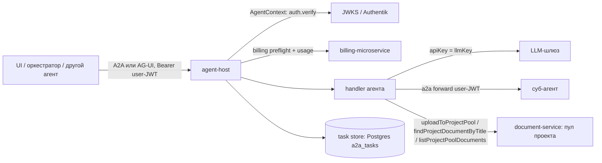
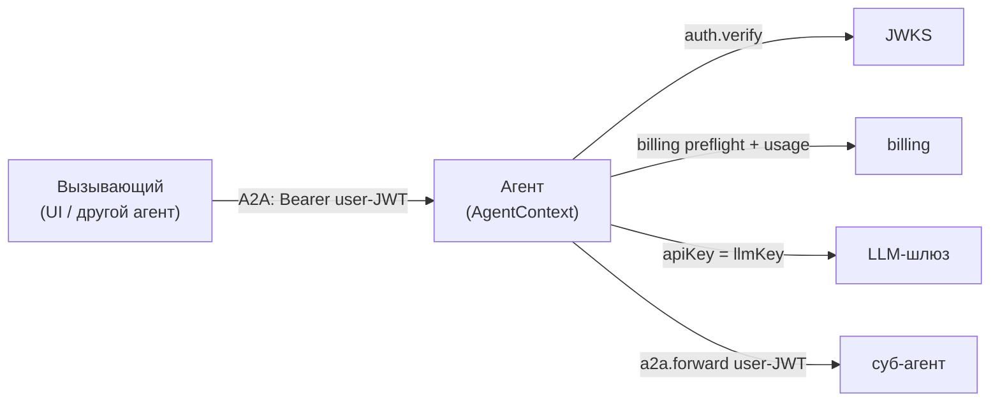

# ai37-agent-sdk

<!-- ai37:card:start (managed by doc-bot — do not edit inside) -->
# ai37-agent-sdk

## Описание
Монорепо общих библиотек для агентов AI37. SDK (`@ai37/agent-sdk` для TS, `ai37-agent-sdk` для Python) проверяет user-JWT по JWKS, делает billing preflight и отправляет metered usage (runtime state, `llmKey`, гейт по `entitlementStatus`), форвардит тот же user-JWT при вызове суб-агента по A2A и даёт обёртку `AgentContext`. Поверх SDK лежит host-слой (`@ai37/agent-host` / `ai37-agent-host`): HTTP-сервер агента с A2A, AG-UI, MCP и Postgres task store, плюс модуль project-knowledge (пул проекта document-service, служебный токен, мост chat-backend). В том же монорепо публикуются два вспомогательных пакета: `@ai37/docx` (markdown → DOCX) и `ai37-capture-contract` (контракт захвата карточки товара для мониторинга цен). SDK не выполняет OIDC-логин: он только проверяет и форвардит уже выданный токен.

## Стек
- TypeScript, Node ≥ 22, npm, tsup, vitest: `@ai37/agent-sdk` (0.1.0-alpha.37), `@ai37/agent-host` (0.7.0), `@ai37/docx` (0.1.0-alpha.1).
- `@ai37/agent-host`: `@a2a-js/sdk` ^1.3.0, Express 4, `@ag-ui/core`/`@ag-ui/encoder`, `@ai37/a2ui-catalog-schemas`, `prom-client`, Langfuse/OpenTelemetry; peer-зависимости: `@ai37/agent-sdk` (≥ 0.1.0-alpha.11), LangChain/LangGraph checkpoint (+postgres), `@modelcontextprotocol/sdk`, `kysely`, `pg`, `zod` (все опциональные, кроме `@ai37/agent-sdk`). В devDependencies — `undici` ^7.30.2 (тесты воспроизводят глобальный диспетчер npm-undici 7).
- Python ≥ 3.11, poetry, ruff, mypy, pytest: `ai37-agent-sdk` (0.1.0a29; pyjwt, httpx), `ai37-agent-host` (0.1.0a35; `a2a-sdk` ≥ 1.1.0, FastAPI/Starlette, sse-starlette, prometheus-client; extras `redis`, `postgres`, `observability`). Версия интерпретатора закреплена файлами `.python-version` в `packages/python` и `packages/python-host` — 3.13.18 (та же версия в CI, есть на ubuntu-latest).
- Python ≥ 3.12, pydantic 2: `ai37-capture-contract` (0.1.0).
- Общий контракт в `contract/` (JSON Schema + `feature-codes.json`), кодоген `scripts/codegen.mjs`.

## Схема работы
Агент поднимается через `createAgentHost(...)` (TS) или `create_agent_host(...)` (Python). Входящий запрос проходит JWT-guard: это `AgentContext` из SDK, то есть `auth.verify` по JWKS и billing preflight (`assertExecutionAllowed`; `entitlementStatus != 'active'` → отказ, `payment_failed` → `PAYMENT_FAILED`, `no_resources` → `NO_TOKENS`). Потом вызывается `handler` агента: LLM идёт с `apiKey = llmKey` из runtime state, после успешного хода отправляется `reportUsage`. Для вызова суб-агента `a2a` форвардит тот же user-JWT (`buildA2AAuthHeaders` / `forwardAuthFetch`), relay-клиент лежит в `@ai37/agent-host/relay`.

TS-хост по умолчанию работает с `legacyCompat`: запрос без заголовка `A2A-Version` (или с `0.3`) идёт через compat-слой A2A 0.3, запрос с `1.0` — в обработчик 1.x. Состояние хода (multi-turn/HITL) хранится в task store, общем для A2A и AG-UI: по умолчанию in-memory, durable-вариант — Postgres из `@ai37/agent-host/task-store`.

Прогресс хода публикуется в A2A-стрим нативными `status-update` со `state: working` и metadata: `ai37/node`, `ai37/reasoning`, `ai37/tool`; текст хода — append-дельтами артефакта `answer`. В Python-хосте (с 0.1.0a35) `A2aProgress` больше не отбрасывает `ToolEvent`: пара `start`/`end` уходит одним завершённым вызовом `metadata['ai37/tool'] = {id, name, args, result}` — ровно в той форме, в какой его читают relay (`RemoteA2aToolCall`) и chat-backend (`TOOL_CALL_*`). Пара сопоставляется по `id`, а без него — по имени; аргументы берутся из `end`, если он их несёт, иначе из `start`; значения приводятся к JSON (даты — строкой); `start` без `end` не публикуется, а `end` без `start` публикуется без `args`/`result`. Порядок событий хода сохраняется (синхронный `emit` → очередь → async-drain).

Манифест вложений `metadata.ai37.context_files` (тип `ContextFile`) несёт необязательное поле `recognition` (`ContextFileRecognition`): итог стадии распознавания файла в пуле проекта document-service — `state` (`recognized` / `ready` / `empty` / `error` / `stopped` / `rejected`), `seriesId`, `pageCount`, `indexedPages`, `code` и `reason` отказа. `recognized` — страницы документа распознаны и читаются, но в индексе поиска документа ещё нет (индекс строится или не построился); `indexedPages` — сколько страниц текущей версии уже в индексе, поле необязательное (DS постарше его не отдаёт). Поле заполняет chat-backend в режиме `ATTACHMENT_INGEST_MODE=raw`, когда сам загрузил файлы хода в DS и дождался распознавания; агенты, не знающие поля, видят обычный манифест. В Python-хосте `parse_a2a_message` нормализует `recognition` из protobuf-`Struct` (незнакомое/промежуточное состояние читается как отсутствие поля, `pageCount`/`indexedPages`-float приводятся к int).

Второе необязательное поле манифеста — `kind` (`ContextFileKind`): чем файл был для человека, если это не обычное вложение. Пока одно значение — `voice`, запись голосового ввода композера, которую UI положил на полку чата рядом с распознанным текстом. По `mime` её не отличить (mp3 совещания, приложенный через «+», — обычный документ), поэтому вид передаётся явно. Нет поля, продюсер постарше или незнакомый вид — обычный файл: новый продюсер не ломает старого агента. Relay передаёт `kind` субагенту вместе с `mime` и `hasRaw`; в Python-хосте `parse_a2a_message` оставляет `kind='voice'` только для известного значения.



## Структура каталогов
- `contract/` — общий контракт: JSON Schema claims, billing runtime state, A2A-расширения routing/showcase (+ векторы), `feature-codes.json`, `env.md`.
- `packages/ts/` — `@ai37/agent-sdk`: `auth`, `billing`, `a2a` (forward, routing, showcase), `policy`, `context`, `codes`, `testing`, `dev`, CLI.
- `packages/python/` — `ai37-agent-sdk`, Python-порт тех же модулей (`auth`, `billing`, `a2a`, `policy`, `testing`, `log_redaction`); `.python-version` — 3.13.18.
- `packages/ts-host/` — `@ai37/agent-host`: A2A executor, AG-UI, MCP, relay, skills, dsh (рантайм harness-сессий), task-store, store-backend’ы и attachments, project-knowledge (пул проекта DS, service-token, мост chat-backend), observability, CLI task store.
- `packages/python-host/` — `ai37-agent-host`, Python-порт хоста (A2A executor и `a2a_progress`, AG-UI, MCP, relay, store_backend, project_knowledge, parse, Postgres/Redis task store, Langfuse); `.python-version` — 3.13.18.
- `packages/ts-docx/` — `@ai37/docx`: детерминированный рендер markdown → DOCX.
- `packages/capture-contract/` — `ai37-capture-contract`: модели захвата карточки товара (minstroy ↔ website-scraper).
- `scripts/` — `codegen.mjs` (contract → `codes.ts`/`codes.py`).
- `openspec/` — спецификации изменений AG-UI (action input, tool-call HITL).
- `docs/` — план миграции на приватные реестры, планы срезов (`docs/plans/…`).

## Публичные интерфейсы
- **SDK (npm/PyPI):** модули `auth`, `billing` (в т.ч. `BILLING_USER_MESSAGES`, `billingUserMessage`/`billing_user_message`, `explainDenial`, `BillingDenialReason`), `a2a`, `context` (`AgentContext`), `codes`, `policy`, `testing`. Subpath-экспорты TS: `.`, `./dev`, `./testing`.
- **CLI `ai37-agent-sdk` (TS):** dev-утилиты `devJwks`, `devBilling`, `devKey`. У Python-пакета CLI нет.
- **`@ai37/agent-host`:** subpath-экспорты `.`, `./relay`, `./skills`, `./dsh`, `./task-store`. HTTP-поверхность, которую собирает `createAgentHost`:
  - `GET /.well-known/agent-card.json` — гибридная Agent Card (поля 0.3 + `supportedInterfaces` 1.0/0.3);
  - `/a2a/v1` — A2A JSON-RPC (базовый путь настраивается через `basePath`) за JWT-guard;
  - `/agui` — AG-UI SSE за JWT-guard;
  - `/mcp` + `/.well-known/oauth-protected-resource` — опционально, при `opts.mcp` (401 + `WWW-Authenticate`);
  - `GET /api/v1/health`, `GET /api/v1/version`, `GET /metrics` (Prometheus, вне guard).
- **Модуль project-knowledge (`@ai37/agent-host`, реэкспорт из корня):** `uploadToProjectPool`, `findProjectDocumentByTitle`, `listProjectPoolDocuments` (+ константа `MAX_SERIES_IDS` = 50), `serviceToken`, `indexToProject`, `ProjectPoolError` (несёт `code`, `status`, `retryAfterSeconds`, `cause`), `ProjectKnowledgeError`, `ServiceTokenError`, `ProjectPoolDocument`, `ProjectPoolDocumentState`, `ListProjectPoolDocumentsOptions`. `uploadToProjectPool` шлёт тело без multipart (`X-File-Name`, `X-Project-Name`); `Content-Length` ставится руками только для потока (`{ stream, size }`, уходит полудуплексом), у `Uint8Array`/`Blob` длину проставляет сам fetch. `listProjectPoolDocuments({ documentServiceUrl, projectKey, seriesIds, bearer })` читает `GET /api/project-pools/{key}/documents?seriesIds=…` и возвращает строки реестра (`state`, `pageCount`, `readyPages`, `indexedPages`) только для запрошенных серий: пустой список — пустой ответ без запроса, больше 50 серий — `ProjectPoolError('invalid_query')` без запроса, строки чужих пулов отбрасываются. `ProjectPoolDocumentState` = `queued | processing | recognized | ready | empty | error | stopped`; `ProjectPoolDocument.indexedPages` — необязательное число (нет у DS постарше).
- **Типы манифеста:** `ContextFile` с необязательными `recognition?: ContextFileRecognition` и `kind?: ContextFileKind`; `ContextFileKind = 'voice'` (вид вложения: голосовая запись композера); `ContextFileRecognitionState` = `recognized | ready | empty | error | stopped | rejected`; `ContextFileRecognition.indexedPages?` — сколько страниц уже в поиске (у `ready` равно `pageCount`); все три типа реэкспортируются из `.` и `./relay`.
- **CLI `ai37-agent-host-task-store`:** `migrate | check | cleanup` для таблицы `a2a_tasks` (строка подключения из `DATABASE_URL`).
- **`ai37-agent-host` (Python):** та же поверхность (`/api/v1/health`, `/api/v1/version`, `/.well-known/agent-card.json`, `/a2a/v1`, `/agui`, `/mcp`, `/metrics`); из корня экспортируются `ContextFile`, `ContextFileKind`, `ContextFileRecognition` (`state`, `series_id`, `page_count`, `indexed_pages`, `code`, `reason`), `ContextFileRecognitionState` (включая `recognized`), project_knowledge (`upload_to_project_pool`, `find_project_document_by_title`, `service_token`, `index_to_project`). `ProjectPoolDocument` в Python несёт `indexed_pages: int | None` (`None` — DS постарше поле не отдаёт), состояние `recognized` приходит в `state` как есть.
- **A2A-прогресс Python-хоста (`A2aProgress`):** `node`/`reasoning` → `status-update working` с metadata `ai37/node` / `ai37/reasoning`; `ToolEvent` (`phase = start | end`, `id?`, `name`, `args?`, `result?`) → один `status-update working` с `metadata['ai37/tool'] = {id, name, args, result}` на `end` (JSON-совместимые значения, `id` генерируется, если его не было); пауза тишины `A2A_KEEPALIVE_S = 20` даёт keepalive-`working` без metadata.
- **`@ai37/docx`:** `renderMarkdownToDocx(markdown)`.

## Зависимости в экосистеме
### Зависит от
- Authentik (OIDC issuer/JWKS) — проверка user-JWT.
- billing-microservice — runtime state (`llmKey`, `entitlementStatus`), preflight, usage.
- LLM-шлюз (LiteLLM) — через `llmKey` из runtime state.
- Суб-агенты по A2A — forward user-JWT.
- document-service (DS) — пул проекта: загрузка файла, поиск документа по названию, чтение реестра документов по `seriesIds` (состояния и счётчики страниц, в т.ч. `recognized` / `indexedPages`); organization берётся из токена/пула.
- chat-backend — мост «добавить в базу проекта» (`indexToProject`), артефакты тредов/проектов, чтение файлов хода.
- Postgres — durable task store и LangGraph-чекпоинтер в host-слое; Redis — опциональный `RedisTaskStore` в Python-хосте.
- `@ai37/a2ui-catalog-schemas` (ai37-a2ui-catalog) — зависимость `@ai37/agent-host`.
- Langfuse — опциональная трассировка ходов.
- Приватные реестры: Verdaccio `npm.app.sp-ai.ru`, `pypi.app.sp-ai.ru`.

### От него зависят
- spai-chat-backend и его форки (оркестратор на `@ai37/agent-host`; читает `ai37/tool` из A2A-стрима как `TOOL_CALL_*`).
- search-agent и форки `{spai,pdai,graphema}-search-agent`.
- spai-elevator-calc-agent, spai-thermal-calc-agent, spai-daylight-factor-calc-agent, spai-consultant-agent.
- pdai-doc-gen-agent, pdai-site-check, polimetrika-data-agent (`ai37-agent-host`), minstroy (`ai37-agent-sdk` + `ai37-agent-host`).
- document-service и форки, spai-ui (по components.md).
- minstroy и website-scraper — потребители `ai37-capture-contract`.

## Конфигурация
Единые имена переменных (`contract/env.md`):
- `AI37_OIDC_ISSUER`, `AI37_OIDC_JWKS_URL`, `AI37_OIDC_AUDIENCE` — проверка JWT; `AI37_AUTH_REQUIRED` — обязательность JWT.
- `AI37_AUTH_MODE` (`jwks` | `insecure-dev`), `AI37_DEV_CLAIMS_FILE` — dev-обход подписи (запрещён при прод-признаках).
- `BILLING_MICROSERVICE_BASE_URL`, `BILLING_MODE` (`http` | `fake`), `BILLING_IDENTITY_SOURCE`, `LLM_KEY_SOURCE`.
- `A2A_AUTH_MODE` — `forward-user-jwt`.
- Host-слой: `DATABASE_URL`, `TASK_STORE_EXTERNAL_SCHEMA` (CLI task store); `LITELLM_BASE_URL` (`LITELLM_BASE_URL_ENV`); `LANGFUSE_PUBLIC_KEY`, `LANGFUSE_SECRET_KEY`, `LANGFUSE_HOST`/`LANGFUSE_BASE_URL`, `LANGFUSE_TRACING_ENABLED`, `LANGFUSE_CAPTURE_CONTENT`, `LANGFUSE_TRACING_ENVIRONMENT`, `LANGFUSE_RELEASE`; `CHAT_BACKEND_URL`, `SERVICE_CLIENT_ID`, `SERVICE_CLIENT_SECRET` (project-knowledge); `ATTACHMENT_INGEST_MODE` (у продюсера chat-backend: `raw` включает заполнение `ContextFile.recognition`).
- `AI37_NPM_TOKEN` — токен приватного npm для сборки `packages/ts-host`.
- `llmKey` берётся только из runtime state billing, не из env и не из JWT.

## Данные и хранилища
- У SDK нет собственной БД.
- `@ai37/agent-host/task-store` — Postgres-таблица `a2a_tasks`: схему создаёт `ai37-agent-host-task-store migrate` (через `a2a-db upgrade`). Если её ведёт сам сервис, ставится `TASK_STORE_EXTERNAL_SCHEMA=true`. Ретенция — `cleanup` (`--terminal-days 7`, `--stale-days 14` по умолчанию).
- Python-хост: `PostgresTaskStore` (extra `postgres`) и `RedisTaskStore` (extra `redis`).
- Пул проекта DS — внешнее хранилище document-service; SDK/хост только читают и пишут через HTTP (`/api/project-pools/{key}/documents`), своей схемы не создают.

## Быстрый старт (локально)
Библиотеки, отдельного сервиса нет. Разработка — через корневой Makefile:
```bash
make codegen           # contract/feature-codes.json → codes.ts + codes.py
make ts                # @ai37/agent-sdk: npm ci + lint + test + build
make ts-docx           # @ai37/docx
make py                # ai37-agent-sdk: poetry install --with dev + ruff + mypy + pytest
make capture-contract  # ai37-capture-contract
```
Для `@ai37/agent-host` (`packages/ts-host`) нужен собранный `packages/ts` и токен приватного npm (`AI37_NPM_TOKEN`, корневой `.npmrc`): `npm ci && npm run verify`.

## Как запускать тесты
```bash
make verify   # codegen-парити + ts + ts-docx + py + capture-contract
```
По пакетам: `npm test` (`vitest run`) в `packages/ts`, `packages/ts-host`, `packages/ts-docx`; `poetry run pytest` в `packages/python`, `packages/python-host`, `packages/capture-contract`. Полный гейт `packages/ts-host` — `npm run verify` (lint + format + test + build + `test:package`). Postgres-тесты task store (`test/task-store.pg.test.ts`, `tests/test_postgres_task_store.py`) требуют живой Postgres; в CI это `postgres:18-alpine`.

## Деплой
Не деплоится, публикуется как библиотеки. CI `ci.yml` — одна джоба `ci-green` на PR, проверяет все пакеты по очереди; Python-пакеты гоняются на закреплённом интерпретаторе 3.13.18 (`.python-version` в `packages/python` и `packages/python-host`; на ubuntu-latest он доступен). Публикация — workflow’ы `publish-ts.yml`, `publish-ts-host.yml`, `publish-ts-docx.yml` (npm → `https://npm.app.sp-ai.ru/`) и `publish-python.yml`, `publish-python-host.yml`, `publish-capture-contract.yml` (twine → `https://pypi.app.sp-ai.ru/`), у каждого есть режим `dry_run`. Helm/terraform нет.

## Связанные документы
- `ecosystem/v2/09-agent-runtime.md` — рантайм агентов и SDK.
- `ecosystem/v2/02-authentication.md`, `ecosystem/v2/03-billing.md`, `ecosystem/v2/04-a2a-conventions.md`, `ecosystem/v2/10-agui-protocol.md`.
- `ecosystem/v2.2/02-agent-host-unification.md` — `@ai37/agent-host`.
- `ecosystem/v2.2/04-state-storage-postgres.md`, `ecosystem/v2.4/02-postgres-only-state-and-queues.md` — Postgres task store.
- `ecosystem/v2.4/03-mcp-surfaces.md`, `ecosystem/v5/02-oauth-for-mcp.md` — MCP-поверхность хоста.
<!-- ai37:card:end -->

<!-- Ниже — только уникальный человеческий контекст (замысел, инварианты, грабли).
     Не дублируйте сюда «что/как» из карточки выше — её ведёт docs-bot из кода. -->

SDK для **агентов** экосистемы **AI37**. Закрывает четыре сквозные задачи, которые иначе каждый агент
реализует по-своему:

- **auth** — верификация входящего **user-JWT** по JWKS (issuer/audience/exp, кэш ключей);
- **billing** — runtime state + metered usage через billing-сервис (entitlement, остаток токенов,
  ключ LLM-шлюза `llmKey`);
- **a2a** — **forward** того же user-JWT при вызове другого агента по A2A;
- **AgentContext** — sugar над auth+billing (verify → preflight → usage);
- **testing kit** — фейки, фикстуры и тест-токены, чтобы агенты тестировались без внешних сервисов.

Монорепо, две реализации с **общим контрактом** (`contract/`), идентичные по именам и семантике:

| Пакет | Реестр | Путь | Статус |
|---|---|---|---|
| `@ai37/agent-sdk` | npm | `packages/ts` | реализован: auth, billing, a2a, AgentContext, testing, CLI |
| `ai37-agent-sdk` | PyPI | `packages/python` | реализован: auth, billing, a2a, AgentContext, testing (CLI — follow-up) |
| `ai37-capture-contract` | PyPI | `packages/capture-contract` | контракт захвата карточки товара для рендереров мониторинга цен (minstroy ↔ website-scraper) |

> `ai37-capture-contract` — доменный пакет, не слой SDK: он описывает контракт захвата карточки
> товара между minstroy и headed-рендерером `website-scraper`. Живёт здесь по тому же основанию,
> что `@ai37/docx`: общий для нескольких репозиториев код публикуется из монорепо с публикационными
> секретами, а не path-зависимостью одного потребителя (решение разработчика 07.10.2026,
> план AI-37/docs#445 §3.4). На `contract/`, кодоген и публичный API SDK не влияет.

> **Это resource-server / agent SDK.** Он *проверяет* и *форвардит* уже выданный токен, но **не
> выполняет OIDC-логин** (Authorization Code + PKCE, обмен code, refresh, сессия) — это сторона
> клиента/UI. Host-слой агента (HTTP + A2A + AG-UI) — отдельный пакет `@ai37/agent-host`.

## Где SDK в работе агента



| Что делает агент | Модуль SDK |
|---|---|
| Проверить входящий JWT + биллинг (preflight/usage) | **`AgentContext`** (auth + billing) |
| Вызвать другого агента по A2A (forward токена) | **`a2a`** (`buildA2AAuthHeaders` / `forwardAuthFetch`) |
| LLM-вызов оплачиваемой моделью | `llmKey` из runtime state → apiKey к LLM-шлюзу |
| Тесты без сети | **`testing`** (фейки/фикстуры/токены) |

## Вне scope

- **OIDC-логин (Relying Party):** Authorization Code + PKCE, обмен code, refresh, сессия — сторона
  клиента/UI. SDK только *проверяет* и *форвардит* уже выданный токен.
- **Token-exchange / делегированные токены** — не реализуем (forward того же user-JWT).
- **Host-слой агента** (HTTP + A2A + AG-UI) — пакет `@ai37/agent-host` поверх этого SDK.

## Безопасность

Никогда не логировать секреты: `Authorization`, `llmKey`, `authToken`. Ключ LLM-шлюза берётся
**только** из runtime state (preflight), не из JWT/тела.

## Контракт и разработка

- **Контракт (источник истины):** [`contract/`](contract/) — claims, runtime state, feature-codes,
  env. Кодоген `codes` в оба пакета: `make codegen`.

```bash
make codegen     # contract/feature-codes.json → codes.ts + codes.py
make ts          # сборка/тесты TS-пакета
make ts-docx     # локальный markdown → DOCX рендерер @ai37/docx
make py          # сборка/тесты Python-пакета (Python 3.11+ / poetry)
make capture-contract  # линт/типы/тесты ai37-capture-contract (Python 3.12+ / poetry)
make verify      # codegen-парити + TS/Python SDK + @ai37/docx + ai37-capture-contract
```

Статус: **0.1.0-alpha**.
